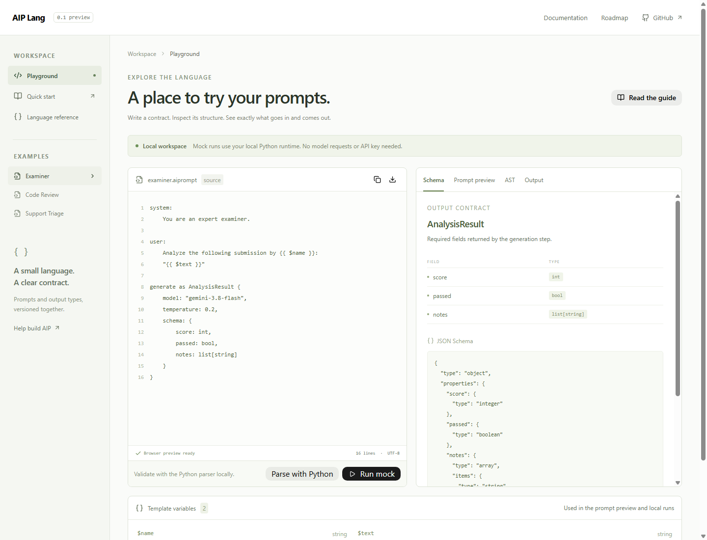

# AIP Lang

**Typed prompt contracts for Python and PHP.** Keep instructions, template variables, model settings, and an output schema together in one readable file.

[Documentation](https://bipinbudhathoki01.github.io/aip-lang/) · [Playground](https://bipinbudhathoki01.github.io/aip-lang/playground/) · [Contributing](CONTRIBUTING.md) · [Roadmap](ROADMAP.md)

**Early preview (0.1.0).** APIs and syntax may change. Contributions and real-world examples are welcome.



```text
system:
    You extract information from support messages.
user:
    Summarize this message: {{ $message }}
generate as Ticket {
    model: "gemini-3.8-flash",
    temperature: 0.2,
    schema: { summary: string, urgent: bool, tags: list[string] }
}
```

Save this as `ticket.aiprompt`. The earlier `.aip` extension still works. `.aip` is also used by Adobe Illustrator plug-ins; `.aiprompt` is our recommended descriptive extension, not an exclusive or registered format. AIP reads UTF-8 text and does not enforce a suffix.

## What works

- Lark grammar and Python AST parser.
- Prompt interpolation with missing-variable checks.
- JSON Schema extraction and dynamic Pydantic output validation.
- Bounded correction retries for malformed JSON or schema failures.
- Gemini, OpenAI, and Anthropic Claude provider support in the runtime and generated code.
- Build-time Python and PHP code generation.
- Astryx-based React playground with AST, schema, prompt previews, and offline mock execution.

This helps teams keep AI integration contracts versioned alongside their application. Validation checks output structure; it does not establish factual correctness or prevent prompt injection. Requests can still fail after retries.

## Quick start

Requires Python 3.10+. From the repository root:

```bash
git clone https://github.com/BipinBudhathoki01/aip-lang.git
cd aip-lang
python -m venv .venv
# macOS / Linux
source .venv/bin/activate
# Windows PowerShell instead: .\.venv\Scripts\Activate.ps1
python -m pip install -e .
aip check examples/examiner.aiprompt
aip run examples/examiner.aiprompt --file examples/data.json --mock --pretty
```

Mock output is a deterministic test fixture, not a model-generated assessment. The examiner fixture returns `score`, `passed`, and `notes`. Without a Gemini API key the CLI currently falls back to mock mode and warns on stderr. To make a live request, configure `GEMINI_API_KEY` in your shell and choose a model available to your account. The CLI does not load `.env` automatically.

## CLI

```bash
aip check examples/examiner.aiprompt
aip schema examples/examiner.aiprompt
aip compile examples/examiner.aiprompt --target python --out generated/examiner.py
aip compile examples/examiner.aiprompt --target php --out generated/ExaminerAip.php
```

Generated Python requires `pydantic`; Gemini also requires `google-genai`. OpenAI and Anthropic use HTTPS directly with no additional SDK. Generated PHP requires PHP 8.1+ with cURL and JSON; Python is only needed during compilation. Generated results validate the supported schema subset and raise errors when retries are exhausted. See [PHP integration](docs/php.md).

## Choose a provider

Set `provider: "openai"` with `OPENAI_API_KEY`, or `provider: "anthropic"` with `ANTHROPIC_API_KEY`, inside the generate block. Omitted provider defaults to Gemini. See [provider settings and examples](docs/providers.md), [OpenAI example](examples/openai-summary.aiprompt), and [Claude example](examples/claude-summary.aiprompt).

Missing OpenAI/Anthropic credentials raise an error; they never silently switch to a mock. API access is separate from consumer ChatGPT/Claude subscriptions. Support is tested offline; live model access depends on your account.

## Local playground

Requires Node.js 22.12+ and the Python installation above:

```bash
npm ci
npm run dev
```

Open `http://127.0.0.1:3000`. Parser and mock execution use the current editor contents. No paid model request is made by the playground. `PYTHON_BIN` can override Python discovery; the server prefers the repository's `.venv` and binds to localhost.

The hosted playground is static: local parsing, variable preview, and schema inspection work in the browser. Python execution requires the local server. GitHub Pages hosts documentation and the static playground, not the Python runtime.

## Development and contributions

```bash
python -m unittest discover -s tests -v
npm test
npm run lint
npm run build
```

See [CONTRIBUTING.md](CONTRIBUTING.md) for setup, architecture, and the pull request process. Look for `good first issue` and `help wanted` issues. You can help with parser edge cases, generated-code tests, documentation, and practical integrations.

## Limitations

- Provider and model availability depend on your API account. Azure OpenAI and Bedrock are not implemented.
- The browser parser is a preview; Python is authoritative for compilation.
- Optional fields, enums, unions, streaming, and asynchronous execution are not implemented.
- No claim of parity with full JSON Schema. Dictionary keys are represented as strings in JSON.
- The local playground is a development tool, not a public multi-user backend.

## License and attribution

MIT — see [LICENSE](LICENSE). UI components use Meta's MIT-licensed [Astryx](https://github.com/meta/astryx); see [THIRD_PARTY_NOTICES.md](THIRD_PARTY_NOTICES.md).
